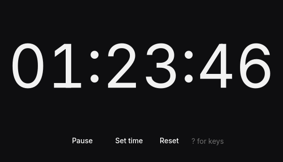

# Stopwatch



A count-up stopwatch for Omarchy (Linux) and Windows that can start from any time. Type `1:30:00`
or `45m` and it counts on from there.

It is built to sit on a screen for hours beside a screen recording without
costing anything: it wakes once a second, on the second, and draws only then.
Measured on an Iris Xe laptop it uses about 0.4% of one CPU core and 0.05% of
the GPU.

The time is saved whenever you act on it, so closing the window or a crash
loses nothing. A watch that was running when it closed keeps counting the time
it was closed, like a phone's stopwatch, and time spent suspended counts too.

## Keys

| Key | Action |
| --- | --- |
| Space | Start or pause |
| E, Enter, or click the time | Set the time (`1:30:00`, `45:00`, `90`, `1h 30m`) |
| ↑ / ↓ | Add or take off a minute |
| Shift ↑ / ↓ | Add or take off an hour |
| R | Reset to zero |
| Ctrl+Z / Ctrl+Shift+Z | Undo / redo a set, reset, or adjustment |
| H | Hide the buttons (clean view for recording) |
| F | Full screen |
| ? | Show the keys |
| Q | Quit (the time is kept) |

Undoing a reset brings back the time as if the reset never happened,
including the seconds that passed since.

## Set up on Windows

Nothing to install: the download carries everything it needs, Qt and the
Visual C++ runtime included. Windows 10 or 11, 64-bit.

1. Open the [latest release](https://github.com/Anish-185/stopwatch/releases/latest) and download
   `stopwatch-windows-x64.zip`.
2. Right-click the zip, choose **Extract All…**, and extract it somewhere it
   can stay, such as `C:\Users\<you>\Apps\stopwatch`. (Run it from the
   extracted folder, not from inside the zip.)
3. Double-click `stopwatch.exe`. The first time, Windows SmartScreen may say
   it "protected your PC" because the app isn't signed: click **More info**,
   then **Run anyway**.
4. To find it in the Start menu, right-click `stopwatch.exe`, choose
   **Show more options → Pin to Start** (or **Send to → Desktop (create
   shortcut)** for a desktop icon).
5. Optional, to have it open when you sign in: press **Win + R**, type
   `shell:startup`, press Enter, and put a shortcut to `stopwatch.exe` in the
   folder that opens.

On Windows the time is kept in `%LOCALAPPDATA%\stopwatch\state.json`. To
remove the app, delete its folder and that one.

### Keeping it light on Windows

The app already does the least it can: it wakes once a second, on a coarse
timer so Windows can batch the wake with others instead of raising the
system timer rate, and draws only when the seconds change. When it's
minimized it draws nothing at all. A few things help further:

- Use it instead of a timer video in the browser. A playing video decodes and
  redraws about 60 times a second; this redraws once.
- Press **H** to hide the buttons, then **F** for full screen on a second
  monitor. Nothing changes on screen except the digits.
- On a laptop with two GPUs, it doesn't need the fast one: in **Settings →
  System → Display → Graphics**, add `stopwatch.exe` and set it to **Power
  saving**.

### Building it on Windows yourself

Only needed to change the code; the release zip is built the same way by
GitHub Actions on every tag (`.github/workflows/windows.yml`).

1. Install **Visual Studio 2022 Build Tools** with the **Desktop development
   with C++** workload.
2. Install **Qt 6.8** with the Qt Online Installer, picking the
   **MSVC 2022 64-bit** component.
3. Open **x64 Native Tools Command Prompt for VS 2022**, then:

   ```bat
   set PATH=C:\Qt\6.8.3\msvc2022_64\bin;%PATH%
   powershell -ExecutionPolicy Bypass -File bin\build-windows.ps1 -Test
   ```

   The ready-to-run folder lands in `dist\stopwatch`.

## Build on Linux (Omarchy)

```sh
bin/build      # build/stopwatch
bin/test       # Qt Test, offscreen
bin/install    # makepkg -fsi, adds it to the app launcher
```

The time lives in `~/.local/state/stopwatch/state.json`.
